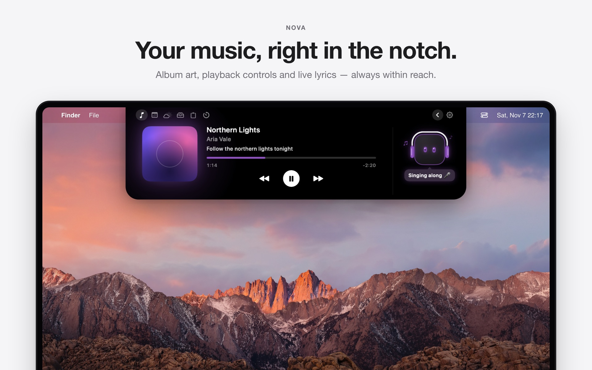
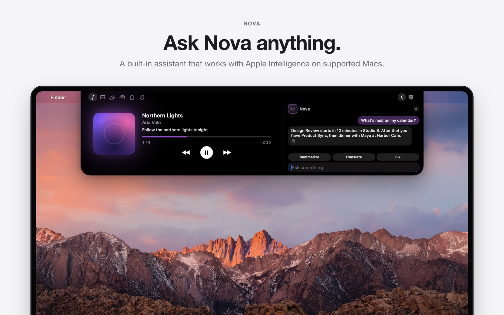
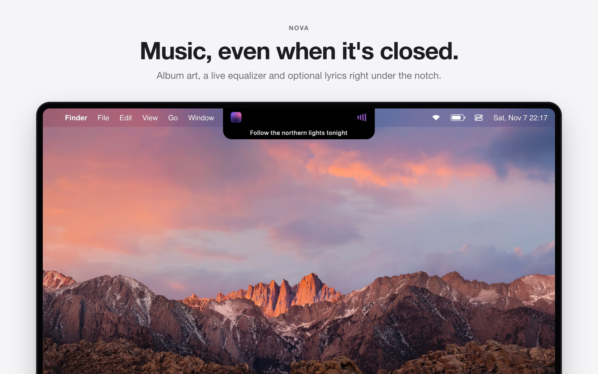
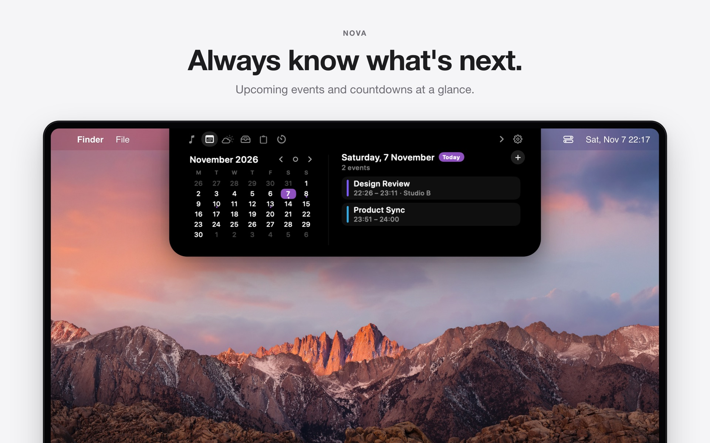
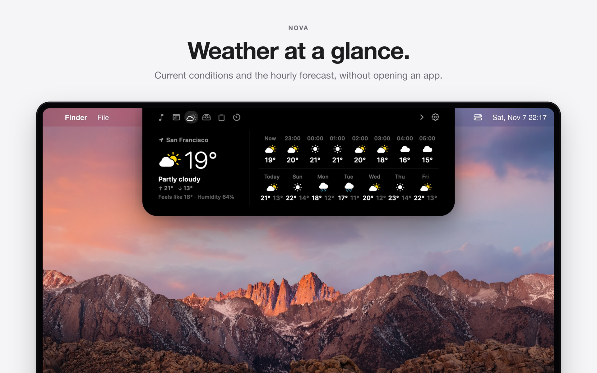
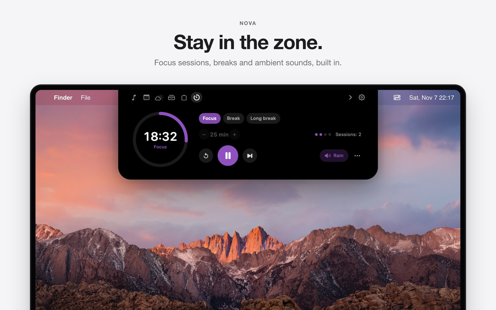
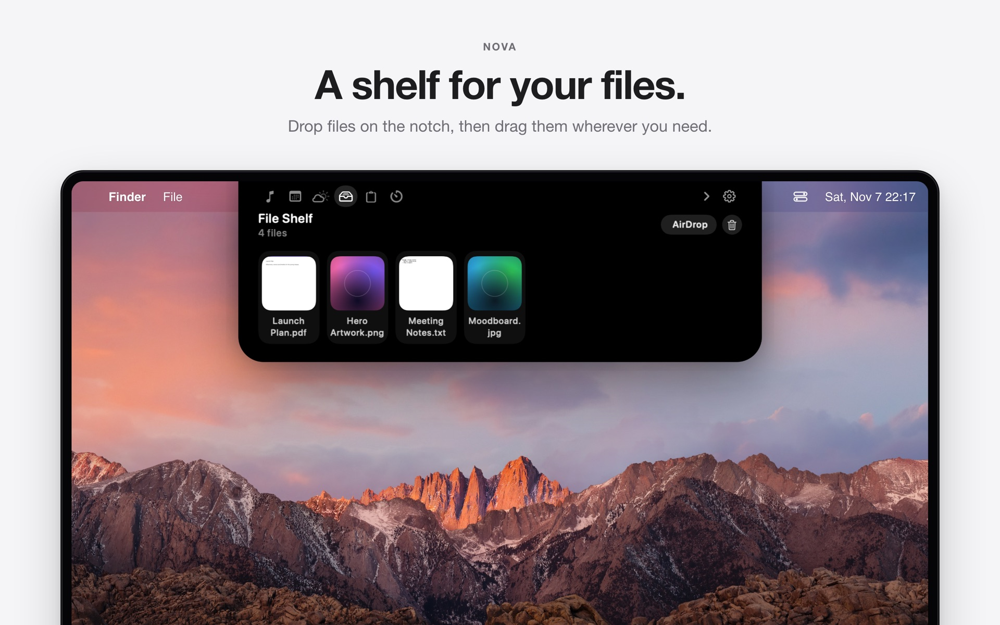
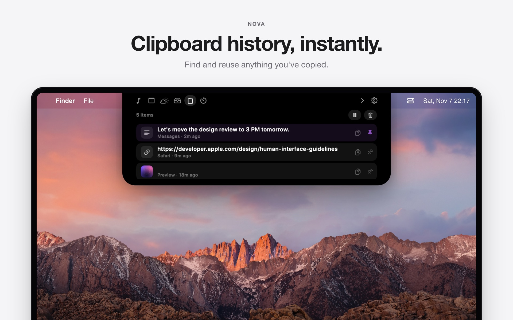
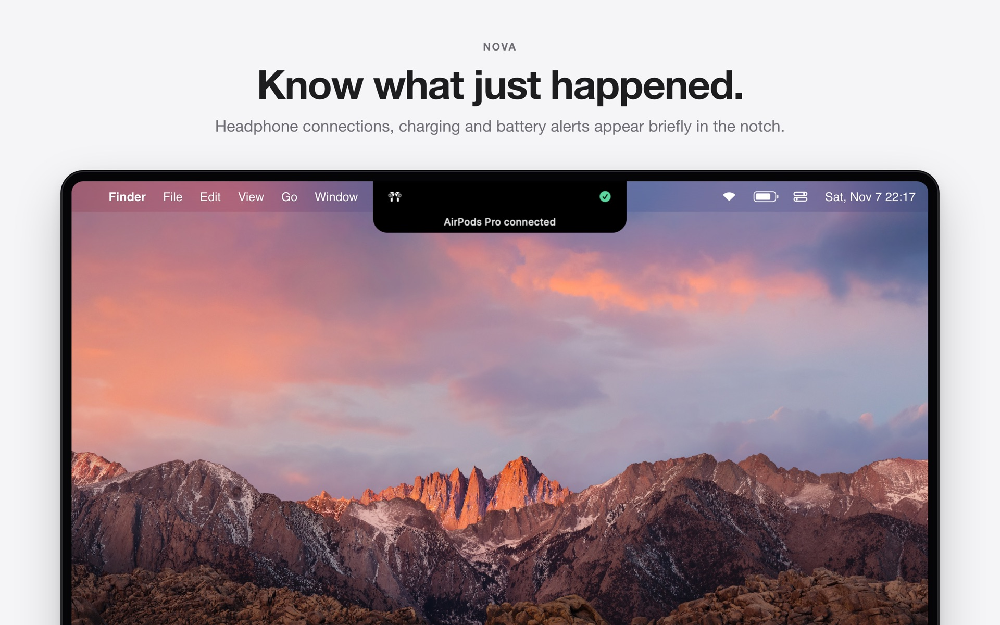

  

<h1 align="center">Nova</h1>

<b>Your Mac's notch, reimagined.</b> 
Music, calendar, weather, files, clipboard, focus timers and an Apple Intelligence assistant — all living in the notch.

  <a href="https://github.com/caglarosman/nova-notch-app/releases/latest/download/Nova.dmg"><b>⬇️ Download Nova for Mac</b></a> ·
  <a href="https://caglarosman.github.io/nova-notch-app/">Website</a> ·
  <a href="https://caglarosman.github.io/nova-notch-app/privacy.html">Privacy</a> ·
  <a href="https://buymeacoffee.com/novapp">☕ Buy me a coffee</a>

## Features

| | |
|---|---|
|  |  |
| **Ask Nova anything** — a built-in assistant that works with Apple Intelligence. | **Music, even when it's closed** — album art, live equalizer and lyrics. |
|  |  |
| **Always know what's next** — upcoming events and countdowns. | **Weather at a glance** — current conditions and hourly forecast. |
|  |  |
| **Stay in the zone** — focus sessions, breaks and ambient sounds. | **A shelf for your files** — drop files on the notch, drag them out later. |
|  |  |
| **Clipboard history** — find and reuse anything you've copied. | **Know what just happened** — headphones, charging and battery alerts. |

## Install

1. Download **[Nova.dmg](https://github.com/caglarosman/nova-notch-app/releases/latest/download/Nova.dmg)** and open it.
2. Drag **Nova** into **Applications**.
3. Launch Nova — it lives in the notch and the menu bar.

**Requirements:** macOS 14 Sonoma or later, Apple Silicon. Apple Intelligence features need a Mac with Apple Intelligence enabled.
Nova is signed with a Developer ID and notarized by Apple.

## Feedback

Found a bug or have an idea? [Open an issue](https://github.com/caglarosman/nova-notch-app/issues).

---

Mac, macOS and Apple Intelligence are trademarks of Apple Inc. Nova is not affiliated with Apple.
